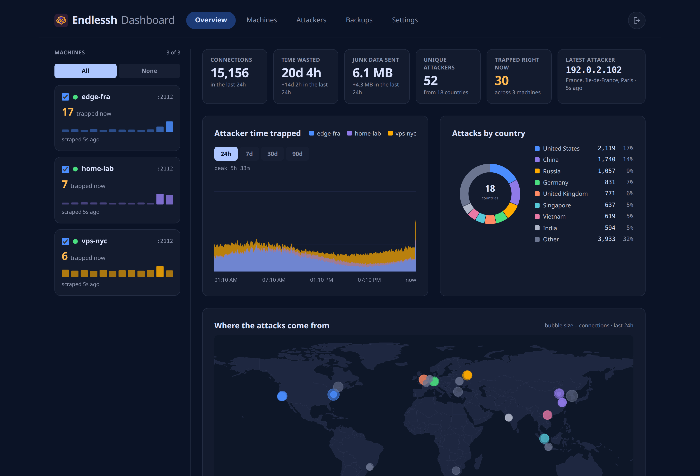
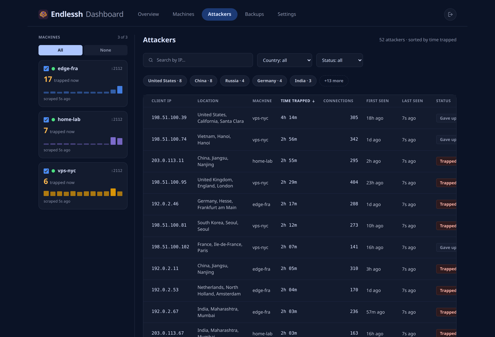
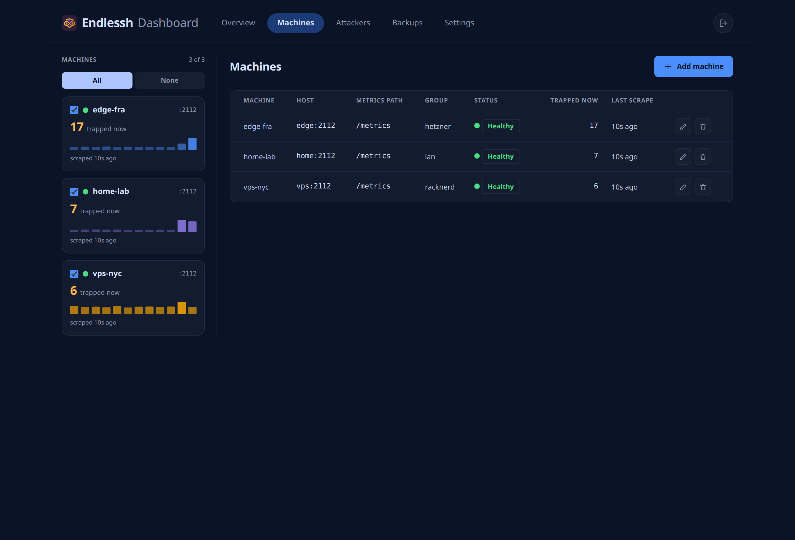

# endlessh-dashboard

A single-container, self-hosted dashboard for [endlessh-go](https://github.com/shizunge/endlessh-go)
SSH tarpits. It polls the Prometheus `/metrics` endpoint of every machine you register, keeps its
own history in SQLite, and serves an embedded web UI showing time wasted, attackers trapped, junk
bytes sent, and per-attacker detail across all your machines. Dark theme by default.

<br clear="left">

[](LICENSE)





## What it is

- One statically linked Go binary in one container: API, scraper, datastore, and UI together.
- Its own history in `/data/endlessh.db`, so totals survive tarpit restarts and counter resets.
- Multi-machine: register as many tarpits as you run, view one or several at once.
- Authenticated by default. No outbound traffic except the scrapes to the machines you registered,
  with one exception you have to switch on yourself: online GeoIP lookups, which send attacker
  addresses to ip-api.com over plain HTTP. Off unless you set `GEOIP_ONLINE=true`.

## What it is not

- **Not a Prometheus or Grafana replacement, and not a dependency on either.** You do not need to
  run Prometheus, an exporter, or Grafana. This app scrapes the endlessh-go `/metrics` endpoints
  directly. If you already run Prometheus + Grafana, keep them — this is for people who do not want
  a monitoring stack just to watch a tarpit.
- **Not a modification of endlessh-go.** Upstream is treated strictly as a black-box metrics source.
  Nothing is installed on the monitored hosts beyond the flags described below.
- **Not a threat-intelligence product.** It shows only what the six endlessh-go metrics contain.
  There is no reputation lookup, no log ingestion, no remote blocklist.
- **Not a phone-home app — with one opt-in exception, named.** No telemetry, no analytics, no update
  check, no CDN assets, no fonts or scripts fetched at runtime, and no map tiles. By default the only
  addresses this container talks to are the tarpits you registered. The exception is
  `GEOIP_ONLINE=true`: switch it on and unplaced attacker addresses are sent, one per request, to
  ip-api.com over plain unencrypted HTTP. That is a real disclosure of who is attacking you to a
  third party, and it never happens unless you ask for it. See
  [Where attacker geography comes from](#where-attacker-geography-comes-from).

## Quick start

There is nothing to build. Pull the published image and run it — the manifest picks `linux/amd64`
or `linux/arm64` to match your machine, so the same two commands work on a PC, a mini-PC, a server,
a Synology NAS or a Raspberry Pi.

**1. Make a directory and drop in two files.**

```bash
mkdir -p endlessh-dashboard && cd endlessh-dashboard
```

**2. `docker-compose.yml`** — copy this as-is:

```yaml
services:
  dashboard:
    image: ghcr.io/aiulian25/endlessh-dashboard:latest
    container_name: endlessh-dashboard
    restart: unless-stopped
    env_file: .env
    ports:
      # Reachable from your LAN. Bind to 127.0.0.1 instead if a reverse proxy
      # is in front of it: "127.0.0.1:18222:18222"
      - "18222:18222"
    read_only: true
    cap_drop:
      - ALL
    security_opt:
      - no-new-privileges:true
    volumes:
      # The only writable path: endlessh.db and backups/ live here.
      - endlessh-data:/data
    tmpfs:
      - /tmp:rw,noexec,nosuid,size=32m
    healthcheck:
      test: ["CMD", "/usr/local/bin/endlessh-dashboard", "-healthcheck"]
      interval: 30s
      timeout: 5s
      start_period: 10s
      retries: 3

volumes:
  endlessh-data:
```

A named volume is used rather than a bind mount, so there is no `chown` step and nothing to get
wrong about permissions — the container runs as uid 65532 and Docker sets the volume up for it. If
you would rather use a host directory, replace the volume with `- ./data:/data` and run
`sudo chown 65532:65532 data` first.

**3. `.env`** — the minimum is one line, but this is the useful starting set:

```ini
# Required on first start. You are forced to change it at first login, after
# which this value is dead and can be deleted.
ADMIN_PASSWORD=change-me-on-first-login

ADMIN_USERNAME=admin
LISTEN_ADDR=:18222
DATA_DIR=/data

# How often each registered tarpit is polled, and how long history is kept.
SCRAPE_INTERVAL=15s
SCRAPE_TIMEOUT=5s
RETENTION_DAYS=90

# Session cookie Secure flag: auto | on | off. auto sets it whenever the request
# arrived over TLS, directly or through a proxy — right for both cases.
SECURE_COOKIES=auto

# Log out and ask for the password again this long after signing in.
SESSION_LIFETIME=12h

# Nightly backups into /data/backups, and how many to keep.
BACKUP_DAILY=false
BACKUP_KEEP_LAST=7

# Geography. Both of these are off by default; the second one is the only
# setting in this app that sends anything to a third party.
GEOIP_MMDB_PATH=
GEOIP_ONLINE=false
```

Every variable, with its default and what it does, is in the
[Configuration](#configuration) table below and in
[`.env.example`](.env.example).

**4. Start it and open the UI.**

```bash
docker compose up -d
```

```bash
curl -fsS http://127.0.0.1:18222/healthz   # -> ok
```

Then open `http://<the-host's-IP>:18222` from any machine on your network — the compose above
publishes the port on every interface, so this works from your laptop or phone with no extra
configuration. See [Reaching it from another machine](#reaching-it-from-another-machine) if it does
not.

Log in with `ADMIN_USERNAME` / `ADMIN_PASSWORD`. The first login forces a password change; the seed
password stops working immediately afterwards, so you can leave it in `.env` or remove it — either
way it is no longer a valid credential. A fresh install shows an empty state prompting you to add
your first machine.

To upgrade later:

```bash
docker compose pull && docker compose up -d
```

Your database is in the named volume, so it survives the upgrade untouched.

## Reaching it from another machine

**It is reachable from your LAN out of the box.** The compose above publishes `18222:18222`, which
binds every interface on the host, and the container listens on `:18222`, which is every interface
inside it. Nothing extra is needed — find the host's address and open it:

```bash
hostname -I | awk '{print $1}'
```

If `http://<that-address>:18222` does not answer, it is one of three things, in the order they are
worth checking:

**1. The host firewall.** The most common cause by far, and the port is unusual enough that no
firewall knows about it. On ufw:

```bash
sudo ufw allow 18222/tcp
```

**2. `LISTEN_ADDR` was narrowed.** `LISTEN_ADDR=:18222` means "every interface inside the
container", which is what you want. Setting it to `127.0.0.1:18222` makes the app listen on the
container's own loopback only, and the published port then reaches nothing — connections are
refused from the LAN even though `docker ps` looks perfectly healthy. Leave it as `:18222` and
control exposure with the `ports:` line instead, which is what it is for.

**3. The port was bound to loopback.** `- "127.0.0.1:18222:18222"` publishes only to the host
itself. That is the right setting when a reverse proxy on the same machine is the only thing that
should reach it — and the wrong one if you want to open the dashboard from your laptop.

### If the page loads but signing in does nothing

This one is worth knowing about, because nothing on screen explains it. `SECURE_COOKIES=on` marks
the session cookie `Secure`, and **every browser silently discards a `Secure` cookie that arrives
over plain `http://`** on anything other than `localhost`. The page loads, the password is correct,
the login request returns 200 — and you land back on the login screen with no error, because the
cookie was thrown away before it was ever stored.

Over a LAN address on plain HTTP, use the default:

```ini
SECURE_COOKIES=auto
```

`auto` sets the flag when the request actually arrived over TLS — directly, or through a proxy that
sent `X-Forwarded-Proto: https` — and leaves it off otherwise. Behind a proxy that terminates TLS
properly it behaves exactly like `on`, so there is rarely a reason to set `on` by hand. Do set it
if you want a deliberate tripwire that makes plain-HTTP access impossible.

### A word about what LAN access means

Plain HTTP on a LAN means the session cookie crosses your network unencrypted. On a home network
you control, that is a normal trade-off. It stops being one the moment the dashboard is reachable
from beyond it — put TLS in front before that happens, and see
[TLS and reverse proxies](#tls-and-reverse-proxies).

## Supported platforms

| | |
| --- | --- |
| **Architectures** | `linux/amd64`, `linux/arm64` — one multi-arch manifest, so `docker pull` picks the right one automatically. |
| **Docker** | 20.10 or newer. Multi-arch manifest support has been in Docker since 1.10, but 20.10 is the oldest release still worth running, and Compose v2 (`docker compose`, no hyphen) ships with it. |
| **Compose file** | No `version:` key — that has been obsolete since Compose v2 and current versions warn about it. |
| **Known to run on** | x86-64 servers and mini-PCs, Synology and other NAS boxes with Docker/Container Manager, Raspberry Pi 3/4/5 on 64-bit Raspberry Pi OS. |
| **Not built for** | 32-bit ARM (`armv7`, e.g. Pi Zero/1/2 or a 32-bit Pi OS install) and 32-bit x86. A 64-bit OS is required even on 64-bit hardware. |

Check what your machine will pull:

```bash
docker manifest inspect ghcr.io/aiulian25/endlessh-dashboard:latest
```

## What it costs to run

Measured, not estimated — a three-machine install with 52 tracked attackers and 36 hours of
per-minute history:

| | |
| --- | --- |
| **Image size** | **6.8 MB.** One statically linked Go binary on `distroless/static`. No shell, no package manager, no interpreter. |
| **Memory** | **~12 MB** resident, steady, whether idle or scraping. It is not a JVM and it is not Node. |
| **CPU** | Effectively **0% at rest**, a brief **~1%** blip on one core each time it polls. Work is proportional to machines × scrape interval, not to how much history you have. |
| **Disk** | **~30 bytes per machine per minute** of history. That is **~4 MB per machine per year**, and the default 90-day retention caps it at **~4 MB per machine**. Attacker rows add ~240 bytes each. |
| **Network** | One HTTP GET per machine per `SCRAPE_INTERVAL`, a few KB each. Nothing else leaves the host unless you switch on `GEOIP_ONLINE`. |

Nothing here scales with the number of *attackers* in a way you will notice — the tarpit's own
metrics endpoint is one small text document however many people are stuck in it.

A Raspberry Pi 3 has ample headroom for this. So does a NAS that is already doing something else.

## TLS and reverse proxies

**The dashboard speaks plain HTTP and expects TLS to be terminated in front of it.** Publish it
through Caddy, nginx, Traefik, or your existing ingress; bind the container port to `127.0.0.1` (as
above) so nothing reaches it except the proxy.

Session cookies are always issued with `HttpOnly` and `SameSite=Strict`. The `Secure` flag follows
`SECURE_COOKIES`, which defaults to `auto`: the flag is set when the request arrived over TLS —
directly, or through a proxy that sent `X-Forwarded-Proto: https` — and left off otherwise, so a
plain-HTTP trial on your own machine still works. Behind a proxy that terminates TLS correctly this
is the same thing as always-on.

If you want the flag set unconditionally, use `SECURE_COOKIES=on`; browsers will then refuse to
store the cookie over plain `http://` on a non-localhost origin, which is a deliberate way to make
sure nobody quietly runs it without TLS. `SECURE_COOKIES=off` forces it off and should stay a
local-testing setting only.

Caddy is the shortest correct example:

```caddyfile
tarpit.example.com {
    reverse_proxy 127.0.0.1:18222
}
```

## Configuration

Everything is environment variables. Secrets come from the environment or a mounted secrets file and
are never written to logs.

| Variable | Default | Meaning |
| --- | --- | --- |
| `LISTEN_ADDR` | `:18222` | Address the HTTP server binds to. Keep the host part empty — `:18222` listens on every interface *inside the container*, which is what lets the published port reach it. Narrowing it to `127.0.0.1:18222` makes the container unreachable from anywhere, including your LAN. Control exposure with the compose `ports:` line instead. |
| `DATA_DIR` | `/data` | Directory for `endlessh.db` and `backups/`. The only path the app writes to. |
| `ADMIN_USERNAME` | `admin` | Seed admin account, created on first start only — changing it later does nothing, since it is read only while the account is being created. At most 64 **bytes** (not characters, so accented or non-Latin names reach the limit sooner); longer is refused at startup. Empty or blank falls back to `admin`. |
| `ADMIN_PASSWORD` | *(required on first start)* | Seed password. Must be changed at first login; ignored once a user row exists. |
| `SECURE_COOKIES` | `auto` | `auto` marks the session cookie `Secure` when the request arrived over TLS (directly or via `X-Forwarded-Proto`). `on` forces it, `off` disables it for local plain-HTTP testing only. |
| `SESSION_LIFETIME` | `12h` | How long a sign-in stays valid before you are logged out and asked for the password again. The clock starts at sign-in and does not slide with activity. Go duration string with no day unit — write `168h`, not `7d`. Minimum `1m`, maximum `720h`. |
| `SCRAPE_INTERVAL` | `15s` | How often each enabled machine is polled. Go duration string. |
| `SCRAPE_TIMEOUT` | `5s` | Total per-scrape timeout (2s connect). Redirects are never followed. |
| `SCRAPE_BLOCK_PRIVATE` | `false` | When `true`, refuse RFC1918 / ULA scrape targets as well (see Security posture). |
| `SCRAPE_ALLOWLIST_CIDRS` | *(empty)* | Comma-separated CIDRs exempt from the blocked-range checks, e.g. `127.0.0.1/32` to allow a tarpit on the same host. |
| `RETENTION_DAYS` | `90` | History older than this is pruned nightly. |
| `GEOIP_MMDB_PATH` | *(empty)* | Path to a mounted GeoLite2 `.mmdb`. Unset means local GeoIP is off entirely. |
| `GEOIP_ONLINE` | `false` | Look unplaced attackers up with an online provider. `true` sends attacker IP addresses to ip-api.com over plain HTTP — the only thing this app ever sends anywhere, and off unless you set it. |
| `GEOIP_ONLINE_RATE_PER_MINUTE` | `40` | Cap on lookups per minute. ip-api.com's free tier allows 45 per source address; 45 is the maximum accepted here, 1 the minimum. |
| `GEOIP_ONLINE_ENDPOINT` | ip-api.com's free endpoint | Lookup URL template. Must be `http://` or `https://` and contain `{ip}` where the address goes. |
| `BACKUP_KEEP_LAST` | `7` | How many backup files to retain; older ones are deleted after each new backup. |
| `BACKUP_DAILY` | `false` | Take an automatic backup once every 24 hours. |

The effective values are visible in the UI under **Settings** (read-only), so you can check what a
running container actually loaded without shell access — the runtime image has no shell.

### Retention

The default is **90 days**. Every night the app prunes per-minute rollups and attacker rows older
than `RETENTION_DAYS`, then reclaims the freed pages with `PRAGMA incremental_vacuum`, so the
database file does not grow without bound. Change it by setting the variable and restarting:

```ini
RETENTION_DAYS=365
```

Lowering it prunes the excess on the next nightly run, not immediately. Retention is the only thing
that deletes history — an unreachable or deleted machine keeps its recorded history.

## The rest of the UI

Every address, every host, one row each, filterable by country, machine and whether they are still
on the hook. The country column appears only when something has resolved an ISO code; with tarpit
labels alone the country is shown in the location column instead.



Machines are registered here, and tested before they are added — the **Test connection** button
proves the tarpit answers on that host and port so you never save a dead target.



## What each monitored endlessh-go host needs

Metrics are **off by default** upstream. Each tarpit you want to monitor must run with
`-prometheus_enabled` (the older `-enable_prometheus` spelling still works):

```bash
endlessh-go -logtostderr -v=1 \
  -prometheus_enabled \
  -prometheus_host=0.0.0.0 \
  -prometheus_port=2112 \
  -prometheus_entry=metrics
```

or in compose:

```yaml
services:
  tarpit:
    image: ghcr.io/shizunge/endlessh-go:latest
    restart: unless-stopped
    command:
      - -logtostderr
      - -v=1
      - -prometheus_enabled
      - -prometheus_port=2112
    ports:
      - "22:2222"      # the tarpit itself
      - "127.0.0.1:2112:2112"   # metrics: reachable by the dashboard, not by the internet
```

Defaults worth knowing: metrics listen on port **2112** at path **`/metrics`**, and the tarpit
itself listens on **2222**. Register the machine in the dashboard with the metrics host, port
`2112`, and path `/metrics`.

Do not expose the metrics port to the internet. It is unauthenticated upstream, and it lists
attacker IPs.

`-geoip_supplier` is **optional**. The dashboard works fine without it — country and location simply
come back empty and the UI leaves those columns out. Turning it on upstream is the cheapest way to
get geography, because the tarpit publishes it in the labels the dashboard already reads; see
[Where attacker geography comes from](#where-attacker-geography-comes-from) for the flag and the two
alternatives.

## Metrics consumed

Six series, all from the endlessh-go `/metrics` endpoint:

| Metric | Labels | Used for |
| --- | --- | --- |
| `endlessh_client_open_count_total` | `local_port` | Connection attempts per tarpit port. |
| `endlessh_client_closed_count_total` | `local_port` | Connections that gave up or dropped. |
| `endlessh_sent_bytes_total` | `local_port` | Junk bytes fed to attackers. |
| `endlessh_trapped_time_seconds_total` | `local_port` | Cumulative attacker time wasted. |
| `endlessh_client_open_count` | `ip`, `local_port`, `geohash`, `country`, `location` | Per-attacker connection count, and the only geography the metrics carry. |
| `endlessh_client_trapped_time_seconds` | `ip`, `local_port` | Per-attacker seconds trapped. |

Two notes that matter more than they look:

- Upstream registers all six as **counters**, including the two per-client series that some
  documentation describes as gauges. Country, geohash, and location live only on
  `endlessh_client_open_count`; the dashboard joins them onto trapped time by IP.
- **Per-client series are ephemeral and counters reset.** A monitored host started with
  `-prometheus_clean_unseen_seconds=N` *deletes* the per-IP series for any attacker not seen for N
  seconds, and every restart of a tarpit resets every counter to zero. A Prometheus + Grafana setup
  absorbs both. A direct scraper cannot — which is exactly why this app keeps its own history: it
  stores deltas with counter-reset detection, and the SQLite database, not the live scrape, is the
  source of truth for totals and for first/last-seen timestamps. An attacker that vanishes from the
  tarpit's metrics stays in your history.

## Where attacker geography comes from

An attacker row is only a country, a place name and a point on the map if something turned its IP
address into one. Three things can, and they win in this order — a source never overwrites what an
earlier one already established:

1. **The labels the tarpit itself publishes**, when it runs with `-geoip_supplier`. Recommended.
2. **A MaxMind `.mmdb` mounted on this dashboard**, for attackers the labels left blank. Offline.
3. **An online lookup**, for whatever the first two could not place. Off by default, and the only
   thing in this app that talks to a third party.

### 1. Labels from the tarpit (recommended, nothing leaves this app)

`endlessh_client_open_count` carries `country`, `location` and `geohash` labels whenever the
monitored host runs with `-geoip_supplier`. The dashboard already parses them on every scrape, and
decodes the geohash into the coordinate the map plots. This dashboard fetches nothing extra for it:
the work was already done on the tarpit host and shipped in the metrics you were scraping anyway.

Point the tarpit at a MaxMind database of its own:

```yaml
services:
  tarpit:
    image: ghcr.io/shizunge/endlessh-go:latest
    restart: unless-stopped
    command:
      - -logtostderr
      - -v=1
      - -prometheus_enabled
      - -prometheus_port=2112
      - -geoip_supplier=max-mind-db
      - -max_mind_db=/geoip/GeoLite2-City.mmdb
    volumes:
      - ./GeoLite2-City.mmdb:/geoip/GeoLite2-City.mmdb:ro
    ports:
      - "22:2222"
      - "127.0.0.1:2112:2112"
```

Upstream also offers `-geoip_supplier=ip-api`, which needs no database file: the **tarpit host** then
makes one plain-HTTP call to ip-api.com per attacker it sees. That is a trade the operator of that
host makes, not this dashboard — but the consequence is the same one described in section 3 below,
with the tarpit's IP as the source address instead of the dashboard's.

Geography from the labels appears on the next scrape, within one `SCRAPE_INTERVAL`.

### 2. A MaxMind database mounted here (offline, accurate)

If the tarpits run without `-geoip_supplier` — or run with a country-only database — the dashboard can
resolve addresses itself from a GeoLite2 `.mmdb` you mount. Download it yourself from MaxMind (a free
GeoLite2 account, `GeoLite2-City.mmdb`); nothing is bundled and nothing is downloaded for you. Mount
it read-only and point `GEOIP_MMDB_PATH` at it:

```yaml
    volumes:
      - ./data:/data
      - ./GeoLite2-City.mmdb:/geoip/GeoLite2-City.mmdb:ro
    environment:
      GEOIP_MMDB_PATH: /geoip/GeoLite2-City.mmdb
```

Lookups are pure-Go reads of that file — no network, no daemon, no CGO. The file must be readable by
uid 65532, and a City database is what gives you coordinates: a Country database carries no position,
and the dashboard stores no coordinate rather than inventing one, so those attackers get a country
but no bubble on the map. Leave `GEOIP_MMDB_PATH` unset and local lookups are off entirely.

### 3. Online lookup (opt-in, off by default)

**This is the one deliberate exception to this project's rule that nothing phones home, and it is off
until you set `GEOIP_ONLINE=true`.**

Switched on, a background worker takes attacker addresses that neither of the sources above could
place and looks them up at `GEOIP_ONLINE_ENDPOINT`, which defaults to ip-api.com's free endpoint:

- **What is sent:** one attacker IP address per request, in the URL, over **plain unencrypted HTTP**
  — the free tier offers no TLS. Nothing identifies you or this install beyond the source address of
  the request itself, which is whichever host is doing the lookup.
- **To whom:** ip-api.com, unless you point `GEOIP_ONLINE_ENDPOINT` somewhere else. It must be an
  `http://` or `https://` URL containing `{ip}` where the address goes.
- **What comes back:** country and country code, region and city, coordinates, and the ISP or hosting
  network behind the address — the only source of that last one.
- **How fast:** at most `GEOIP_ONLINE_RATE_PER_MINUTE` requests a minute, evenly spaced, default 40.
  ip-api.com's free tier allows **45 requests per minute per source address** and throttles hosts
  that exceed it, so 45 is the maximum this app will accept and 40 leaves headroom. A large backlog
  therefore takes minutes to hours to clear, which is the intended trade.
- **Answers are remembered** for the life of the process, including "the provider does not know this
  address", so the same address is not looked up twice.
- **Redirects are not followed**, the response is size-capped, and a request that fails teaches the
  worker nothing — it simply tries again on a later sweep.

Nothing enables this by accident. It is `false` unless set, and when it is on the container logs a
warning at startup naming the endpoint and the rate, so an operator reading the log can see what this
install is doing.

### What has no location, and what is late

- **Private, loopback and link-local addresses have no location.** A tarpit on a LAN sees attackers
  from that LAN; upstream labels them `Unknown` (or `Geohash off` when it has no supplier at all),
  which the dashboard discards rather than showing as data — placeholders are not places. MaxMind has
  no record of them either, and they are never sent to the online provider at all. Those
  rows keep their IP, their times and their counts, and stay off the map and out of the country
  breakdown. Some public addresses are simply absent from GeoLite2 too, and land the same way.
- **Geography is not backfilled instantly.** An attacker recorded before you mounted a database or
  switched the online lookup on has no location until the backfill worker reaches it: it sweeps once
  a minute, most-recently-seen first, 100 addresses at a time, and the online rate limit — not the
  sweep — is what paces it. A resolved address is written to every machine's copy of that row, since
  where an address is does not depend on which tarpit met it.
- **The map is a country outline compiled into the binary** (Natural Earth 1:110m, public domain),
  not a tile service. Nothing is fetched when you look at it, and no map provider learns that you
  opened the page or what you were looking at.

## Backups and restore

Backups are taken with SQLite's own `VACUUM INTO`, never a raw file copy, so a backup taken while
the scraper is writing is still consistent. Files land in `/data/backups/`, so they are on the same
volume as the database — copy them off-host if you want them to survive losing the volume.

From the **Backups** card on the **Settings** page you can take a backup, download it, restore one,
and delete one. Daily
backups run automatically when `BACKUP_DAILY=true`, keeping the last `BACKUP_KEEP_LAST`
files.

The same thing from the API:

```bash
# take one
curl -fsS -X POST -b cookies.txt -H "X-CSRF-Token: $TOKEN" http://127.0.0.1:18222/api/backups

# list
curl -fsS -b cookies.txt http://127.0.0.1:18222/api/backups

# download
curl -fsS -b cookies.txt -o backup.db \
  http://127.0.0.1:18222/api/backups/endlessh-20260824-030000.db

# restore (verified with PRAGMA integrity_check, then swapped in on restart)
curl -fsS -X POST -b cookies.txt -H "X-CSRF-Token: $TOKEN" \
  http://127.0.0.1:18222/api/backups/endlessh-20260824-030000.db/restore
```

A restore is applied atomically on restart and a corrupt file is refused rather than swapped in. The
plainest disaster recovery, if the container will not start at all, is to stop it, replace
`data/endlessh.db` with a backup file, and start it again.

## Scale ceiling

Be honest with it and it will be boring and reliable. **Tens of machines at a 15-second interval are
comfortable** on modest hardware — that is the design point: a handful to a few dozen tarpits,
thousands of attacker rows, one or two people looking at it.

The datastore is a single SQLite file with a single writer. That is the right choice for this scale
and the wrong choice for a fleet. If you point 500 machines at it, or drop `SCRAPE_INTERVAL` to `1s`
across dozens of hosts, you will serialize behind that writer and the database file will grow fast —
that is the tool being used outside its stated range, not SQLite failing. At that size you want
Prometheus and Grafana, which is a perfectly good answer and one this project does not try to be.

Idle footprint on a handful of machines is a few tens of MB of RSS and effectively no CPU.

## Security posture

- **Authentication required by default.** No unauthenticated access to attacker data or machine
  configuration. Argon2id password hashing, server-side sessions, forced password change on first
  login, login rate limiting, CSRF tokens on every mutating request, and a `'self'`-only CSP.
- **Scrape targets are SSRF-vetted** on every add and edit, and again at scrape time. Host syntax,
  port range, and path are validated; DNS is resolved and the result checked before dialing, and the
  vetted IP is the one actually dialed, so a DNS answer that changes afterwards cannot redirect the
  request. Loopback, link-local (`169.254.0.0/16` and `fe80::/10`, which covers cloud metadata at
  `169.254.169.254`), multicast, and unspecified addresses are rejected. Redirects are never
  followed; response size and time are capped.
- **Documented deviation: RFC1918 private ranges are allowed by default.** The original security
  requirement said to block "arbitrary internal addresses", but home-lab and single-host tarpits on
  private LANs are the primary use case for this tool, and blocking private ranges would break it.
  Set `SCRAPE_BLOCK_PRIVATE=true` if all your targets are public and you want the tighter posture.
  Anything you genuinely need — including loopback for a tarpit on the same host — can be permitted
  precisely with `SCRAPE_ALLOWLIST_CIDRS` instead of relaxing the rule globally.
- **Container hardening**: `gcr.io/distroless/static-debian12:nonroot` pinned by digest, no shell and
  no package manager in the image, runs as uid 65532, `read_only: true` root filesystem,
  `cap_drop: [ALL]`, `no-new-privileges`, and `/data` as the only writable path.
- **No phone-home by default, one opt-in exception**: out of the box the only outbound connections
  the container makes are the scrapes to the machines you registered. Setting `GEOIP_ONLINE=true`
  adds one more — unplaced attacker addresses sent to ip-api.com over plain HTTP, rate-limited, with
  private and loopback addresses never sent and redirects never followed. It is off unless set, and
  when it is on the container says so in a startup warning naming the endpoint. There is no
  telemetry, no update check, and no external asset; the `'self'`-only CSP is the runtime tripwire if
  that ever regresses.
- **SQL safety**: parameterized statements only; machine names and labels are user-supplied.
- **Dependency hygiene**: a short, justified dependency list, with `govulncheck` in CI.

## Testing a machine before you add it

The **Add machine** and **Edit machine** dialogs carry a **Test connection** button. It runs one
real scrape against the host you typed — the same validation, dialling and parsing a scheduled
scrape uses — and reports what it found: the address it reached, which tarpit port that instance is
trapping on, how many attackers are already in its metrics, and whether GeoIP is on. A target that
cannot work is refused with the reason, so a dead or mistyped host is caught while you are still
typing rather than becoming a red row afterwards.

## Troubleshooting

### A machine shows "down"

Status is `down` after repeated consecutive scrape failures, `degraded` after the first one. The UI
shows the last error text on the machine — read that first. Then, from a host that can reach the
target:

```bash
curl -fsS http://TARPIT_HOST:2112/metrics | head -20
```

- Empty or connection refused: the tarpit is not running with `-prometheus_enabled`, or it is bound
  to `127.0.0.1` on its own host, or the port is not published from its container.
- Works from your laptop but not from the dashboard: it is a network path or firewall issue between
  the two containers or hosts, not a dashboard problem. Two containers on the same Docker network
  can address each other by service name.
- Error text mentions a blocked address: your target resolves to loopback, link-local, or (with
  `SCRAPE_BLOCK_PRIVATE=true`) a private range. Allow exactly what you need with
  `SCRAPE_ALLOWLIST_CIDRS`.

History is never discarded because a machine went down. When it comes back, scraping resumes and the
status returns to `ok`; the gap stays visible in the charts.

### No data appearing

- Give it two scrape intervals. Nothing shows up before the second scrape, because the first one
  only establishes the counter baseline to compute deltas from.
- A tarpit no attacker has touched yet reports zeros. Confirm real traffic by connecting to it
  yourself: `nc TARPIT_HOST 2222` should hang and slowly print junk. Leave it open for a minute and
  you should appear in the Attackers list.
- Check that the machine is `enabled` and selected in the machine multi-select at the top of the
  page — an empty selection means all enabled machines, but an explicit selection can hide the one
  you are looking at.
- Check the selected time window. A 24h window on a tarpit that was down all day looks identical to
  a broken dashboard.

### Forgotten password

The runtime image has no shell, so recovery is done against the database file with a throwaway
container. Clearing the user rows makes the app re-seed from `ADMIN_PASSWORD` at the next start,
with the forced-password-change flow active again:

Set a new `ADMIN_PASSWORD` in `.env` first, then find your data volume and clear the user rows:

```bash
docker volume ls --filter name=endlessh-data
```

```bash
docker compose stop dashboard
```

```bash
docker run --rm -v endlessh-dashboard_endlessh-data:/data alpine sh -lc \
  'apk add --no-cache sqlite >/dev/null && sqlite3 /data/endlessh.db "DELETE FROM sessions; DELETE FROM users;"'
```

```bash
docker compose up -d dashboard
```

The volume is named after the directory you ran `docker compose up` in, so substitute whatever
`docker volume ls` reported above. If you swapped the named volume for a bind mount, use
`-v "$PWD/data:/data"` instead.

Take a backup before doing this if the data matters to you — **Settings → Backups** has a
**Back up now** button, and the file can be downloaded from there.

### GeoIP labels are empty

Blank country and location are a supported, normal state, not an error — the UI hides those columns
rather than showing placeholder text. Causes, in order of likelihood:

- The monitored host runs without `-geoip_supplier` (the upstream default is `off`) and you have not
  set `GEOIP_MMDB_PATH` here. Do one or the other.
- `GEOIP_MMDB_PATH` is set but the file is not actually mounted, is not readable by uid 65532, or is
  a Country database where a City database is expected — the file must be a MaxMind GeoLite2
  `.mmdb`. Check the startup logs and the GeoIP status shown on the Settings page.
- Rows recorded before you mounted the database are filled in by the backfill worker, not instantly:
  it sweeps once a minute, 100 addresses at a time, most-recently-seen first.
- The address is private, loopback or link-local. Nothing can place those, by design.
- Some public IPs are genuinely absent from GeoLite2. That is a gap in the database; only the opt-in
  online lookup (`GEOIP_ONLINE=true`) will fill it, and nothing is fetched online while it is off.

## Versions and upgrading

Images are published to GitHub Container Registry with two kinds of tag:

| Tag | Meaning |
| --- | --- |
| `ghcr.io/aiulian25/endlessh-dashboard:1.1.0` | An exact release. It never changes. |
| `ghcr.io/aiulian25/endlessh-dashboard:latest` | Whatever the newest release is. Moves every time one ships. |

`latest` is the friendlier default and is what the quick start uses. Pin the version tag instead if
you would rather decide for yourself when the container changes underneath you:

```yaml
image: ghcr.io/aiulian25/endlessh-dashboard:1.1.0
```

The database is migrated forward automatically on start, and every migration so far is additive.
Take a backup before a major-version upgrade anyway — **Settings → Backups** makes it one click, and
restoring is one more.

## Credits

This dashboard watches somebody else's tarpit. The tarpits deserve the credit:

- **[endlessh](https://github.com/skeeto/endlessh)** by Chris Wellons (skeeto) — the original SSH
  tarpit, and the idea this whole thing rests on: answer a scanner with an endless SSH banner and
  let it sit there.
- **[endlessh-go](https://github.com/shizunge/endlessh-go)** by shizunge — the Go implementation
  that adds the Prometheus metrics this dashboard reads. Without its `/metrics` endpoint there
  would be nothing to show. It is treated strictly as a black-box source; nothing here modifies or
  redistributes it.

The world map outline is derived from [Natural Earth](https://www.naturalearthdata.com/) public
domain vector data, projected once and embedded, so the map needs no tile server and no request
that could tell anyone who is looking at your dashboard.

## Licence

MIT — see [LICENSE](LICENSE).
